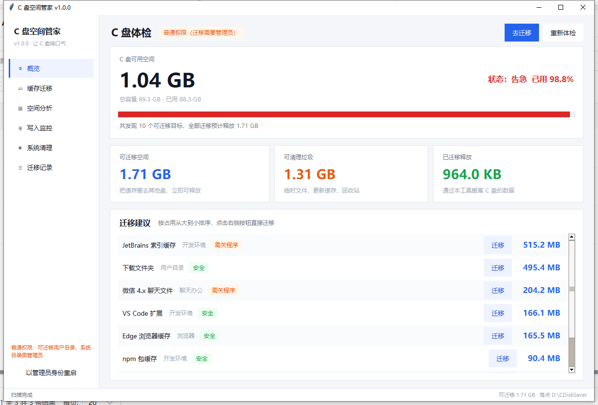
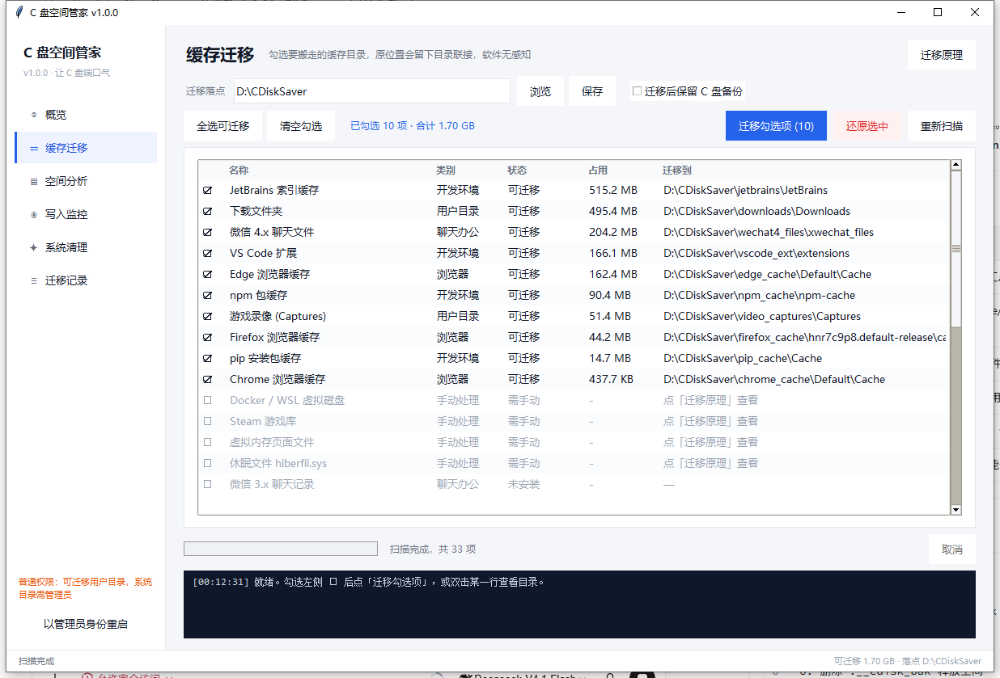
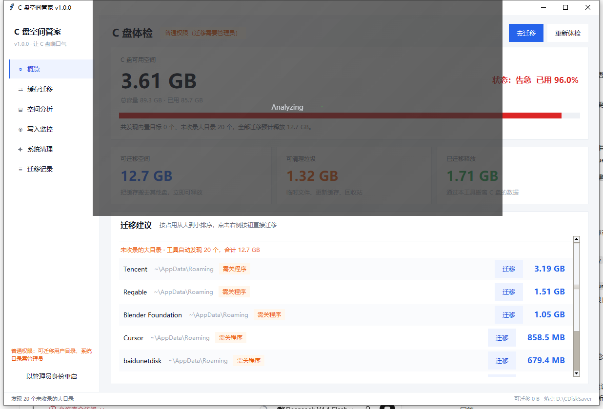

# C 盘空间管家 · CDiskSaver

> 把占空间的缓存目录整体搬到其他盘，原位置留一个目录联接（Junction）——软件照常运行，C 盘立刻多出几十 GB。

**Windows 10 / 11** · **Python 3.9+** · **零第三方依赖** · **MIT**



---

## 为什么做这个

我的 C 盘 89.3 GB，用到只剩 1.6 GB。Windows 开始更新失败、临时文件写不进去。

试过常规办法，都不解决根本问题：

- 删缓存 → 一周后长回来
- 改软件设置 → 大部分软件压根没有「缓存路径」这个选项
- 挪整个 `AppData` → 直接搞坏系统

真正的问题是：**这些缓存必须存在，只是不该存在 C 盘。**

所以这个工具做的事不是「删」，而是「搬」：把目录整体移到别的盘，在原位置留一个目录联接。程序仍然按原路径读写，Windows 在文件系统层把请求转到新位置——**程序完全感知不到**。

## 和传统清理工具的区别

| | 传统清理工具 | C 盘空间管家 |
|---|---|---|
| 手段 | 删文件 | 搬迁 + 目录联接 |
| 效果 | 清完还会长回来 | 一劳永逸，缓存继续写，只是写到别的盘 |
| 程序感知 | —— | 无感知，不用改任何设置 |
| 可逆 | 删了就没了 | 每条迁移都能一键还原 |

## 核心原理

```
1. robocopy 复制到 D 盘          ← 失败则直接放弃，C 盘原样不动
2. 校验文件数量与总字节           ← 不一致就删掉副本，重新来过
3. 源目录改名为 xxx.__cdisk_bak   ← 只是改名，秒级完成
4. mklink /J 建立目录联接         ← 失败则改回原名，完整回滚
5. 校验联接可读
6. 删除 .__cdisk_bak 释放空间     ← 可勾选「保留备份」跳过这步
7. 写入 journal.json 台账
```

**以 Edge 缓存为例**，工具会把下面这些目录搬到 `D:\CDiskSaver\edge_cache\`：

```
C:\Users\<你>\AppData\Local\Microsoft\Edge\User Data\Default\Cache
                                              \Default\Code Cache
                                              \Default\GPUCache
                                              \Default\ShaderCache
                                              \Default\Service Worker\CacheStorage
```

之后 Edge 仍按原路径读写，NTFS 在底层重定向到 D 盘。书签、密码、登录态一律不受影响——你只搬了缓存目录。

> **为什么不改 Edge 设置？** `--disk-cache-dir` 参数和 `DiskCacheDir` 策略只覆盖部分缓存，
> 升级或新建快捷方式后容易失效。目录联接是文件系统级的，对任何软件通用，不需要软件配合。

## 功能

| 页面 | 作用 |
|---|---|
| **概览** | C 盘健康度体检、自动发现未收录的大目录、按体积排序的迁移建议 |
| **缓存迁移** | 33 个内置目标，勾选 ☐ 即迁移；也可随时还原 |
| **空间分析** | 扫描任意目录，目录树 + 大文件排行，找到元凶直接迁走 |
| **写入监控** | 实时看谁在往 C 盘写文件；快照对比找出「偷偷长胖」的目录 |
| **系统清理** | 临时文件、更新缓存、回收站、休眠文件等，带体积预估与风险分级 |
| **迁移记录** | 每次迁移的台账，任何一条都能一键还原 |



## 内置 33 个目标

<details>
<summary>展开查看完整列表</summary>

**聊天办公**：微信 4.x / 微信 3.x / QQ·TIM / 企业微信 / 钉钉

**浏览器**：Edge（8 类缓存目录）/ Chrome / Firefox

**开发环境**：pip / npm / yarn / pnpm / cargo / rustup / go 模块 / go 编译缓存 / Gradle / Maven / NuGet / Conda / HuggingFace / PyTorch / Android SDK / Android AVD / VS Code 扩展 / JetBrains / Unity

**用户目录**：下载文件夹 / 游戏录像

**需手动处理**（工具内提供命令）：Docker·WSL 虚拟磁盘 / Steam 游戏库 / 页面文件 / 休眠文件

</details>

## 智能发现

内置目标永远覆盖不全。所以概览页会在后台再扫一遍用户目录（约 10 秒），自动挑出**体积 ≥ 200 MB 且不在内置库里**的目录。



判定规则：

- 只保留最具体的一层：`AppData\Roaming\Tencent` 够大，就不会再把整个 `AppData` 报出来
- **排除**：已安装程序（`AppData\Local\Programs`）、npm 全局包、个人文件（桌面/文档/图片/视频）、UWP 数据、Microsoft 系统目录、OneDrive、工具自身运行时
- **去重**：已被内置目标覆盖的不重复列出
- **风险分级**：路径含 cache / logs / traces / updater → 「安全」；其余 → 「需关程序」

> 排除这几类是因为：把「已安装的程序」当缓存搬走会直接搞坏软件，把「桌面」当缓存搬走更离谱。
> **宁可少报，不可误报。**

## 快速开始

### 方式一：直接运行（推荐）

```
双击 启动.bat
```

会自动挑一个**带 tkinter 的** Python 解释器（项目内 `.venv` → 各版本安装目录 → PATH），
逐个跑 `import tkinter` 检测，不带 tkinter 的直接跳过。

> 为什么要检测？精简版、内嵌版、部分工具自带的 Python 不含 tkinter，
> 直接用会报 `ModuleNotFoundError`，而 `pythonw` 无控制台，窗口一闪就没，看不到错误。

### 出问题就双击 `诊断.bat`

逐个列出机器上所有 Python 及 tkinter 检测结果，最后以控制台模式启动，异常可见。

### 方式二：手动运行

```bat
python main.py
```

### 打包成单文件 exe

```bat
build.bat
```

产物：`dist\C盘空间管家.exe`（约 11 MB，无控制台窗口）

### 自检

```bat
python selftest.py          :: 引擎：迁移 / 联接 / 扫描 / 还原
python tools\ui_smoke.py    :: 界面：所有页面回调逐个触发
```

- `selftest.py` 真实执行「造数据 → 迁移 → 联接校验 → 体积扫描 → 还原 → 数据比对」，
  外加 Edge 多配置文件结构的批量迁移测试。
- `ui_smoke.py` 把六个页面的点击/双击/勾选回调全部调用一遍，专治「回调签名写错、
  属性名写错」这类在 `pythonw` 下静默失败的问题。**改界面之后务必跑一次。**

## 安全设计

- **不删未经校验的数据**：只删「已经核对过、目标盘有完整副本」的 C 盘原件
- **任何一步失败都回退**：复制失败放弃、校验不一致删副本、改名失败改回、联接失败还原
- **全程可逆**：每次迁移写入 `journal.json`，迁移记录页可一键还原
- **默认不保留备份**，但可以勾选「迁移后保留 C 盘备份」（占空间，仅建议首次尝试时用）

数据存放位置：

| 内容 | 路径 |
|---|---|
| 配置 | `%LOCALAPPDATA%\CDiskSaver\config.json` |
| 迁移台账 | `%LOCALAPPDATA%\CDiskSaver\journal.json` |
| 目录快照 | `%LOCALAPPDATA%\CDiskSaver\snapshots.json` |
| 错误日志 | `%LOCALAPPDATA%\CDiskSaver\error.log` |

## 常见问题

**Q：迁移时提示「源目录被占用」？**
对应软件还在运行。完全退出它（托盘也要退）再试。不会损坏数据。

**Q：需要管理员权限吗？**
目录联接本身不需要。但 `ProgramData`、`Windows` 下的目录需要管理员才能读写，
处理这些时请右键「以管理员身份运行」。

**Q：会不会影响软件更新？**
一般不会。极少数软件升级时会重建数据目录，此时联接可能被覆盖，
在「迁移记录」里还原再迁一次即可。

**Q：为什么不支持 Docker / WSL / Steam？**
它们的虚拟磁盘和游戏库有自己的注册信息，直接搬会坏。
工具里给了对应的官方迁移命令（列表中标「需手动」）。

**Q：`AppData\Local\Temp` 能迁吗？**
不建议。它是临时目录，应该用「系统清理」清掉，而不是搬走。

## 项目结构

```
CDiskSaver/
├─ 启动.bat                双击运行（自动挑带 tkinter 的 Python）
├─ 诊断.bat                环境诊断 + 控制台模式启动
├─ build.bat               打包 exe
├─ main.py                 主窗口、侧边导航、页面调度
├─ selftest.py             端到端引擎自检
├─ cdisk/
│  ├─ util.py              路径 / 权限 / 统计 / 联接判定
│  ├─ targets.py           33 个内置迁移目标 + 检测规则
│  ├─ discover.py          智能发现：找出内置库之外的大目录
│  ├─ migrate.py           迁移引擎、回退、台账
│  ├─ scan.py              目录体积树 + 大文件排行
│  ├─ watch.py             ReadDirectoryChangesW 监听 + 快照对比
│  ├─ clean.py             系统垃圾清理项
│  ├─ service.py           配置与扫描结果缓存
│  ├─ ui.py                主题与控件
│  └─ pages/               六个页面
├─ assets/                 图标
└─ tools/                  截图、图标生成、界面冒烟测试
```

> 三个 `.bat` 都是 **CRLF 换行 + GBK 编码**。用编辑器改它们时务必保持这两点，
> 否则 cmd.exe 会把脚本解析成乱码命令。

## 免责声明

本工具会移动真实数据并创建目录联接。虽然内置了校验与回滚，**仍建议重要数据先行备份**。
使用本工具造成的任何数据损失，作者不承担责任。

## License

[MIT](LICENSE)
